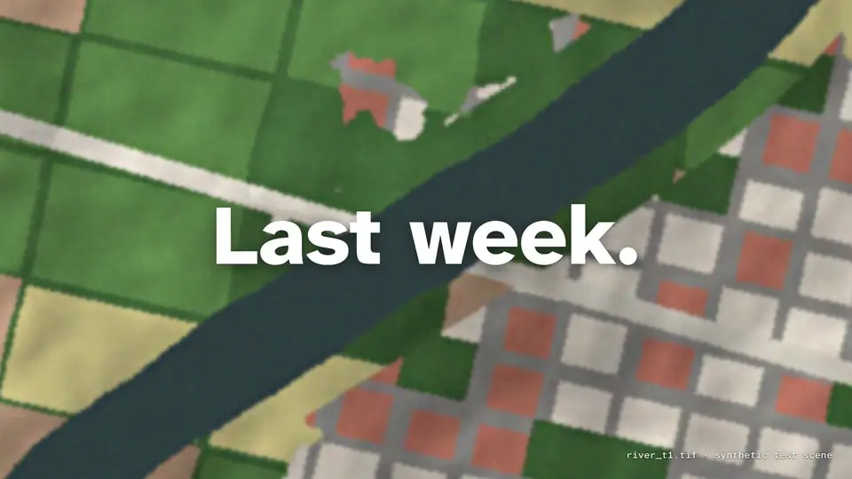
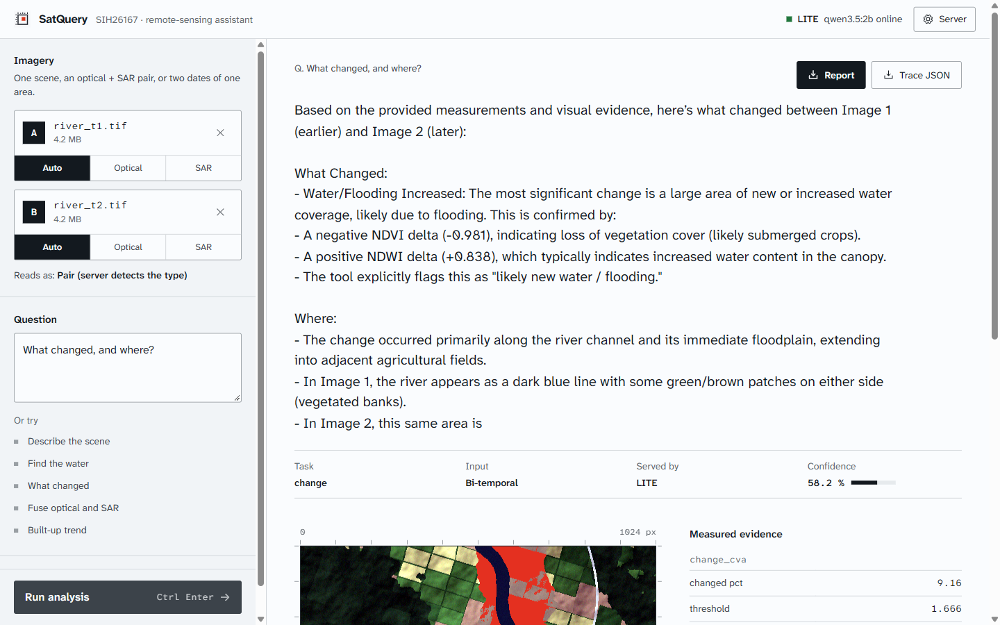
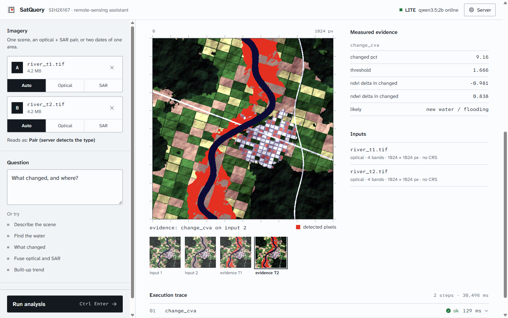
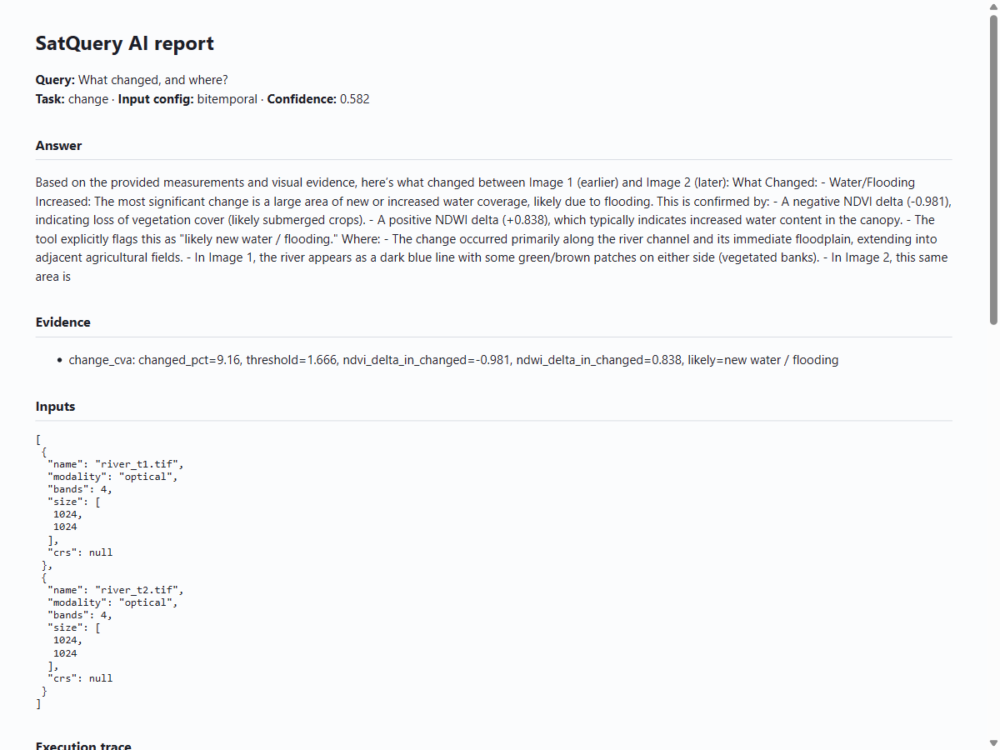
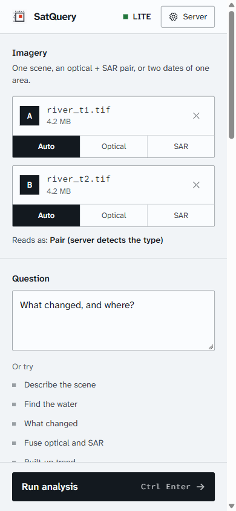
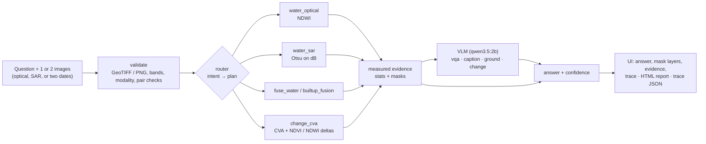

# SatQuery AI

**Ask a satellite image a question in plain words. Get an answer you can check.**
An agentic vision-language assistant for remote-sensing imagery: optical, SAR and two-date pairs. Smart India Hackathon 2026, problem statement **SIH26167**.

[](https://github.com/akn-official/satquery-ai/actions/workflows/ci.yml)
[](LICENSE)
[](https://akn-official.github.io/satquery-ai/)
[](https://kaggle.com/kernels/welcome?src=https://github.com/akn-official/satquery-ai/blob/main/kaggle/main_server.ipynb)

<a href="https://akn-official.github.io/satquery-ai/"></a>

**[▶ Watch the full film with sound (30 s)](https://akn-official.github.io/satquery-ai/)**. The scenes in the film are synthetic test scenes. Every number, answer, trace and box on screen is real SatQuery output on them ([how it was made](video/source/BRIEF.md)).

## What it looks like

| The answer, with its evidence | The mask it measured |
|---|---|
|  |  |

| Downloadable report ([open the sample](https://akn-official.github.io/satquery-ai/sample-report.html)) | Phone width |
|---|---|
|  |  |

All four are screenshots of the real app (laptop LITE mode, qwen3.5:2b) running on the synthetic river scenes in [`video/source/assets`](video/source/assets). The full trace of that run: [`docs/sample-trace.json`](docs/sample-trace.json).

## How it works



The tools measure first; the language model answers with those numbers in front of it, and every step (tool, parameters, status, time, stats) lands in the trace.

**Two ways to serve, same code.** **MAIN** runs on a free Kaggle T4 notebook ([`kaggle/main_server.ipynb`](kaggle/main_server.ipynb)) behind a cloudflared tunnel with an access token. **LITE** runs on a 4 GB laptop: Ollama plus CPU tools. The UI tries MAIN first and falls back to LITE.

## Results so far

Measured, and honest about the limits:

| Check | Result |
|---|---|
| Behaviour tests (`test_behaviour.py`): identity pair, reversed order, mask vs truth, routing | **9 / 9 pass** |
| Identity pair (same image twice) | 0.0 % changed, label `no change` |
| Reversed order | 6.59 % changed both ways; NDWI delta flips sign, label flips to `water loss` |
| Flood mask vs truth (synthetic pair) | IoU **1.00**, 6.59 % of the scene |
| Optical + SAR water | pixel agreement **0.983**; SAR really used in the plan |
| Security retest (token, Origin, chunked bodies, size caps, CSP) | **22 / 22** pass ([SECURITY.md](SECURITY.md)) |
| Fuzz (VRT/SSRF, EPS, 200 bands, NaN, bad params) | 0 crashes, clean 422s, SSRF listener got 0 hits |

**Not done yet:** everything is tested on synthetic GeoTIFFs only (real Cartosat-2S / RISAT pairs are the hidden evaluation set); the remote-sensing fine-tune on BigEarthNet has not started; the 2B model sometimes misquotes numbers or invents objects, which is what the fine-tune is for. IoU 1.00 is because the synthetic pair shares one noise field; real scenes will score lower.

| Feature | Status |
|---|---|
| Single-image VQA | Works (qwen3.5:2b + measured tool evidence) |
| Captioning and grounding | Both work. Grounding = VLM box ∩ index mask |
| Bi-temporal change VQA | Works (CVA + Otsu with a noise floor, NDVI/NDWI deltas, a `likely` label) |
| Optical + SAR joint analysis | Works (NDWI + SAR water, fusion, built-up fusion) |
| Agent with a tool registry and an auditable trace | Works (router + REGISTRY, per-step trace) |
| GUI + downloadable report | Works (React UI, HTML report, trace JSON) |
| Remote-sensing fine-tune on BigEarthNet | Not started |

## Run it (laptop, Windows)

```
python -m venv .venv && .venv\Scripts\pip install -r requirements.txt
ollama pull qwen3.5:2b                                              # keep Ollama running
cd web && npm install && npm run build && cd ..
.venv\Scripts\python -m uvicorn satquery.server:app --port 8000     # UI + API at http://127.0.0.1:8000
.venv\Scripts\python test_smoke.py                                  # expect "smoke ok" (works with the model offline)
.venv\Scripts\python test_behaviour.py                              # behaviour tests, exit 1 on any FAIL
```

For MAIN, open the notebook on Kaggle (badge above) with a T4 GPU, set a `SATQUERY_TOKEN` secret, run all, then paste the printed URL and token into the UI's **Server** panel.

## Repository

- `satquery/`: backend (validation, tools + REGISTRY, router, VLM client, FastAPI server, Gradio fallback).
- `web/`: React UI ([design rules](web/README.md)).
- `kaggle/`: MAIN server notebook.
- `samples/`: synthetic test GeoTIFFs used by the tests and the UI's sample buttons.
- `docs/`: screenshots, a sample report and trace, and the [project site](https://akn-official.github.io/satquery-ai/).
- `video/`: the film, its preview loop, and `source/` (scene, score and scene-generation scripts).
- [REPORT.md](REPORT.md): research and plan. [SECURITY.md](SECURITY.md): security model and audit. [Operating and presentation guide (PDF)](output/pdf/SatQuery_AI_Operating_and_Presentation_Guide.pdf).

## License

[MIT](LICENSE). Fonts: Atkinson Hyperlegible Next and Mono, SIL Open Font License.
